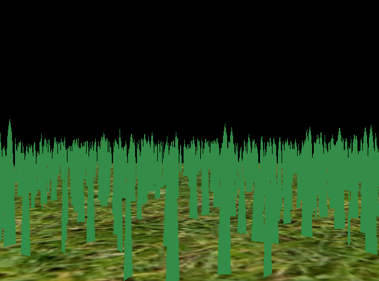
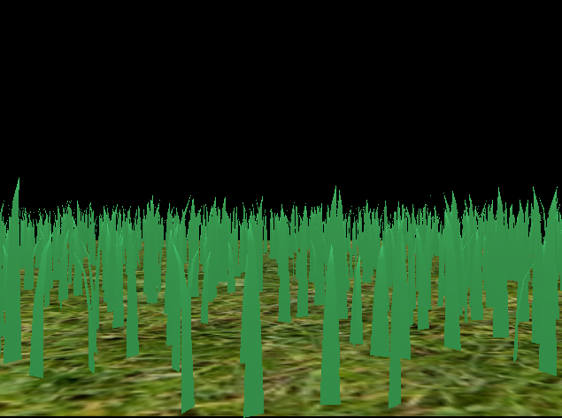
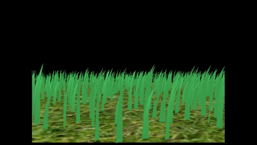
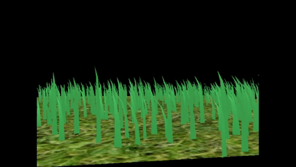
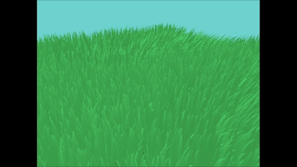
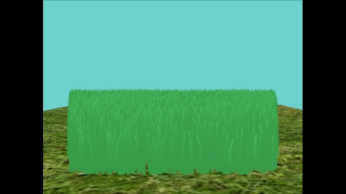
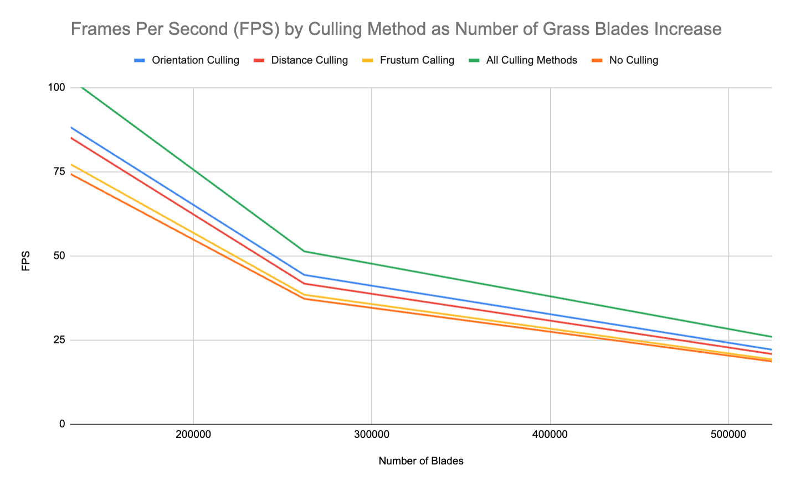
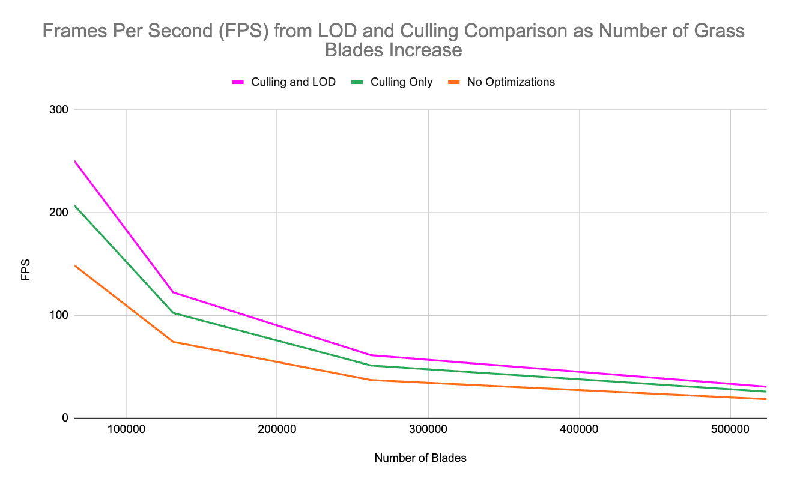

Vulkan Grass Rendering
==================================

**University of Pennsylvania, CIS 565: GPU Programming and Architecture, Project 5**

* Rose Kelly
  * [LinkedIn](www.linkedin.com/in/rose-kelly-b480b01a8)
* Tested on: Windows 11, i7-13700F @ 2.10 GHz 16GB, RTX 4060-Ti 8GB (PC)

## Summary

This project uses Vulkan to implement the techniques described in the paper, [Responsive Real-Time Grass Rendering for General 3D Scenes](https://www.cg.tuwien.ac.at/research/publications/2017/JAHRMANN-2017-RRTG/JAHRMANN-2017-RRTG-draft.pdf) to generate a field of grass and simulate movement on each blade of grass by calculating and applying wind, gravity, and recovery forces, as well as performance enhancing culling and LOD.

### Features Implemented

#### Grass Rendering

I rendered the grass by running a separate graphics pipeline that takes 3 Bezier control points for each blade of grass, and uses those control points in a tessellation shader to generate additional vertices to form the curved shape of each grass blade. 

The image above shows the grass blades rendered without any forces simulated on them, so they point straight up.

#### Forces Simulation

Forces are calculated in a compute shader that runs before the graphics pipeline that processes the grass blades. The overall force is calculated from the individual wind, gravity and recovery forces and then applied to the second and third control points for the grass blade to change its shape and show the natural effect of the forces on the blade of grass.

- Gravity: calculated using a constant representing the force of gravity on the blade of grass as well as the blade's front vector to cause the blade of grass to droop in its front direction.

- Recovery: calculated using a stiffness constant set for each blade of grass to counteract forces bending the grass from its default state (straight up).

In the above image the grass has gravity and recovery simulated on each blade. You can see the slight bend in each blade in its equilibrium state balancing gravity and recovery.

- Wind: I created my own wind equation based on time and grass location (final wind equation result shown in the gif at the top of the README). I use my wind equation with the formula I implemented from the original paper to calculate the total force of the wind on a blade. The paper's formula also takes into account how tall the grass is and how aligned it is with the wind, as a tall blade of grass that is completely aligned with the direction of the wind will be more affected by it than a short blade of grass that is not aligned with the wind direction.

In the gif above a simple sin-based wind is applied to the grass.

#### Culling

Culling also occurs in the compute shader that runs before the grass graphics pipeline to identify blades that can be culled without significantly impacting the quality of the grass field render.

- Orientation Culling: I test if a grass blade is close to perpendicular (the camera sees only the thin edge of the grass blade) with the camera view vector by checking if the dot product of the blade's front vector and the view vector is within a set range. If the grass blade is close enough to being perpendicular, it gets culled and is not rendered.

Note in the left side of the above gif you can see two blades of grass that are close to perpendicular to the camera. As the camera rotates around this part of the grass field, they get independently culled as they get within range of being perpendicular to the camera.

- Distance Culling: the blades of grass are split into buckets based on how far they are from the camera. Buckets further from the camera have more blades of grass culled since they reducing the number of blades for locations far from the viewer has a lower impact on the overall image since farther away objects show less detail and occupy a smaller total area on screen.

The above gif shows how the distance culling "thins" the density of grass in the buckets farther from the camera. The maximum distance was shortened for the above capture to more clearly illustrate the effect.

- View-frustum Culling: any blades that are entirely outside of the view frustum are culled since performing calculations for them would be a waste of resources as they don't show up on screen.

In the above gif, the frustum bounds were made tighter than the actual view frustum to illustrate the culling occurring.

## Performance Analysis

### Culling Method Comparison

| Number of Blades |	Orientation Culling |	Distance Culling |	Frustum Calling	| All Culling Methods |	No Culling |
| ------------- | ------------- | ------------- | ------------- | ------------- | ------------- |
|65536	|188.6|	166.6|	155.6|	207.4 |	149 |
|131072	|88.2|	85.1|	77.2	|102.5|	74.3 |
|262144	|44.3|	41.7|	38.4|	51.3|	37.2 |
|524288	|22.1|	20.8|	19.2|	25.9|	18.6|

### LOD Performance Improvement

| Number of Blades |	Culling and LOD |	Culling Only |	No Optimizations|
| ------------- | ------------- | ------------- | ------------- |
|65536	|250.8	|207.4	|149|
|131072|	122.5|	102.5|	74.3|
|262144|	61.3	|51.3	|37.2|
|524288|	30.7	|25.9	|18.6|
