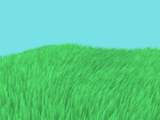
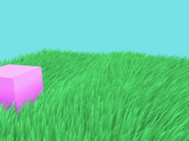
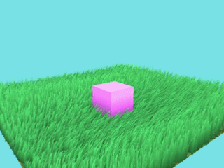

Vulkan Grass Rendering
==================================

**University of Pennsylvania, CIS 565: GPU Programming and Architecture, Project 5**

* Rose Kelly
  * [LinkedIn](www.linkedin.com/in/rose-kelly-b480b01a8)
* Tested on: Windows 11, i7-13700F @ 2.10 GHz 16GB, RTX 4060-Ti 8GB (PC)

### Controls

Rotate the Camera: Hold the left mouse button down and move the mouse on screen
Zoom the Camera: Hold the right mouse button down and move the mouse up or down to change zoom level
Move the Cube: hold down the W, A, S, and D, keys to move in thes forward, back, left and right directions from the starting camera pov

## Summary

This project uses Vulkan to implement the techniques described in the paper, [Responsive Real-Time Grass Rendering for General 3D Scenes](https://www.cg.tuwien.ac.at/research/publications/2017/JAHRMANN-2017-RRTG/JAHRMANN-2017-RRTG-draft.pdf) to generate a field of grass and simulate movement on each blade of grass by calculating and applying wind, gravity, and recovery forces, as well as performance enhancing culling and LOD.

### Features Implemented

#### Grass Rendering

I rendered the grass by running a separate graphics pipeline that takes in 3 Bezier control points for each blade of grass, and uses those control points in a tessellation shader to generate additional vertices to form the curved shape of each grass blade. 

The image above shows the grass blades rendered without any forces simulated on them, so they point straight up.

#### Forces Simulation

Forces are calculated in a compute shader that runs before the graphics pipeline that processes the grass blades. The overall force is calculated from the individual wind, gravity and recovery forces and then applied to the second and third control points for the grass blade to change its shape and show the natural effect of the forces on the blade of grass.

- Gravity: calculated using a constant representing the force of gravity on the blade of grass as well as the blade's front vector to cause the blade of grass to droop in its front direction.

- Recovery: calculated using Hooke's law and a stiffness constant set for each blade of grass to counteract forces bending the grass from its default state (straight up).

In the above image the grass has gravity and recovery exerted on each blade. You can see the slight bend in each blade in its equilibrium state balancing gravity and recovery.

- Wind: I created my own wind equation based on time and grass location (final wind equation result shown in the gif at the top of the README). I use my wind equation with the formula I implemented from the original paper to calculate the total force of the wind on a blade. The paper's formula also takes into account how tall the grass is and how aligned it is with the wind, as a tall blade of grass that is completely aligned with the direction of the wind will be more affected by it than a short blade of grass that is not aligned with the wind direction.

In the gif above a simple sin-based wind is applied to the grass.

#### Culling

Culling also occurs in the compute shader that runs before the grass graphics pipeline to identify blades that can be culled without significantly impacting the quality of the grass field render.

- Orientation Culling: I test if a grass blade is close to perpendicular (the camera sees only the thin edge of the grass blade) with the camera view vector by checking if the dot product of the blade's front vector and the view vector is within a set range. If the grass blade is close enough to being perpendicular, it gets culled and is not rendered.

Note in the left side of the above gif you can see two blades of grass that are close to perpendicular to the camera. As the camera rotates around this part of the grass field, they get independently culled as they get within range of being perpendicular to the camera.

- Distance Culling: the blades of grass are split into buckets based on how far they are from the camera. Buckets further from the camera have more blades of grass culled since they reducing the number of blades for locations far from the viewer has a lower impact on the overall image since farther away objects show less detail and occupy a smaller total area on screen.

The above gif shows how the distance culling "thins" the density of grass in the buckets farther from the camera. The maximum distance was shortened for the above capture to more clearly illustrate the effect.

- View-frustum Culling: any blades that are entirely outside of the view frustum are culled since performing calculations for them would be a waste of resources as they don't show up on screen.

In the above gif, the frustum bounds were made tighter than the actual view frustum to illustrate the culling occurring.

#### LOD

I also added a level of detail optimization that tesselates grass closer to the camera at a higher level than grass further from the camera. This has a negligible effect on render quality since grass farther from the camera is smaller on the screen anyway and it is harder to tell how many vertices it has. In fact, this method can enable increasing the percieved quality of the image without decreasing performance since you can get the same performance with higher tessellation for closer grass blades and lower tessellation for farther away blades.

#### Interactive Movable Cube with Grass Interaction 

Additionally, I added a cube you can control using the WASD keys that pushes down the grass its on top of and prevents intersection with grass blowing into it. The existing forces simulation that I described above, especially the recovery force, works with this added feature to create natural looking grass movement as the cube moves through the grass.

#### Sky Box

I also added a sky box to the scene with a sky blue color to give the sense that--from certain camera angles--this could be a grassy field somewhere rather than a patch of grass existing in a black void.

## Performance Analysis

#### Performance as Number of Grass Blades Increases

| Number of Blades |	Culling and LOD |	Culling Only |	No Optimizations|
| ------------- | ------------- | ------------- | ------------- |
|65536	|250.8	|207.4	|149|
|131072|	122.5|	102.5|	74.3|
|262144|	61.3	|51.3	|37.2|
|524288|	30.7	|25.9	|18.6|

Generally as the number of blades increases, FPS appears to decay exponentially. The fact the the performance decrease falls off as the number of blades increases could be due to the decreasing impact of the overhead of every feature implemented. For example, while the culling methods are optimizations, there is overhead to setting them up via calculating if a blade qualifies for culling and passing in additional data, such as the camera position. As the number of blades increases, the relative weight of this overhead may decrease since it is being applied to more blades of grass.

### Culling Method Comparison

| Number of Blades |	Orientation Culling |	Distance Culling |	Frustum Calling	| All Culling Methods |	No Culling |
| ------------- | ------------- | ------------- | ------------- | ------------- | ------------- |
|65536	|188.6|	166.6|	155.6|	207.4 |	149 |
|131072	|88.2|	85.1|	77.2	|102.5|	74.3 |
|262144	|44.3|	41.7|	38.4|	51.3|	37.2 |
|524288	|22.1|	20.8|	19.2|	25.9|	18.6|

The above graph compares the performance of the different culling methods I described in the previous section. As you can see, the grass renderer clearly performs better with all of these methods applied (green line) than without them (orange line). For ~65.5k blades of grass, the renderer using all culling methods performed 26.5% better than using no culling.

Interestingly, the method that seems to contribute the most to the culling performance improvement is orientation culling. It is worth noting I tested all of these methods from the same camera angle on the same size patch of grass. Given how dense the grass is at these high numbers of grass blades, it is likely that many blades have an orientation within range to be culled from the testing angle. The distance culling appeared to have the next biggest performance improvement. This makes sense as it is thinning specified buckets of the grass patch and is guaranteed to be culling a portion of grass blades. I would expect this culling method to have had a larger impact than orientation culling, but the size of the patch of grass is relatively small so the true potential of distance culling did not have an opportunity to shine in this limited test. Frustum calling had the smallest relative performance improvement over the non-culling test data. This could be due to the camera angle I chose for this test as it encompasses most of the grass in the scene. Each of these methods could have a larger contribution in specific situations; long views of grass with a great variety in distance would benefit greatly from distance culling, being in the middle of large grass field with grass all around the camera would benefit from frustum viewing, and highly dense grass could benefit more from orientation culling.

### LOD Performance Improvement

| Number of Blades |	Culling and LOD |	Culling Only |	No Optimizations|
| ------------- | ------------- | ------------- | ------------- |
|65536	|250.8	|207.4	|149|
|131072|	122.5|	102.5|	74.3|
|262144|	61.3	|51.3	|37.2|
|524288|	30.7	|25.9	|18.6|

As shown in the graph and table above, adding LOD further improved performance. For ~65.5k blades of grass, applying the LOD optimization with the culling methods increased FPS by roughly 20.9% over just using the culling methods. I set my max tessellation and the rate tessellation decreased over distance from the camera based on appearance in my simulation, but depending on one's goals, performance could likely be improved even further than shown here depending on your expectations of acceptable tessellation detail level.

| Number of Blades |	% Increase in Performance From Both Culling and LOD|	
| ------------- | ------------- |
|65536	| 68.3	|
|131072|	64.9|
|262144|	64.8	|
|524288|	65.1	|

While it might appear on the graph that the performance increase from culling and LOD drastically decreases as the number of blades of grass increases, this is actually not the case. As shown in the table above, the percent FPS increase from the approach using both culling and LOD compared to the approach using neither, remains relatively similar as the number of grass blades increases.

### Resources Used
* [GLFW Input Guide](https://www.glfw.org/docs/3.3/input_guide.html)
* [Responsive Real-Time Grass Grass Rendering for General 3D Scenes](https://www.cg.tuwien.ac.at/research/publications/2017/JAHRMANN-2017-RRTG/JAHRMANN-2017-RRTG-draft.pdf)
* [CIS565 Vulkan samples](https://github.com/CIS565-Fall-2017/Vulkan-Samples/tree/master/samples/5_helloTessellation)
* [Official Vulkan documentation](https://www.khronos.org/registry/vulkan/)
* [Vulkan tutorial](https://vulkan-tutorial.com/)
* [RenderDoc blog on Vulkan](https://renderdoc.org/vulkan-in-30-minutes.html)
* [Tessellation tutorial](https://ogldev.org/www/tutorial30/tutorial30.html)